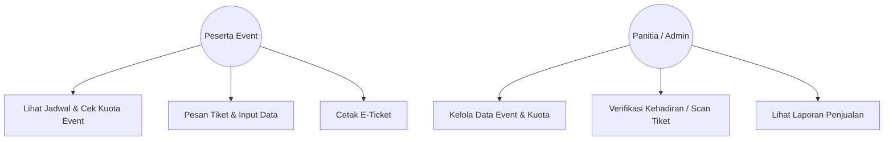
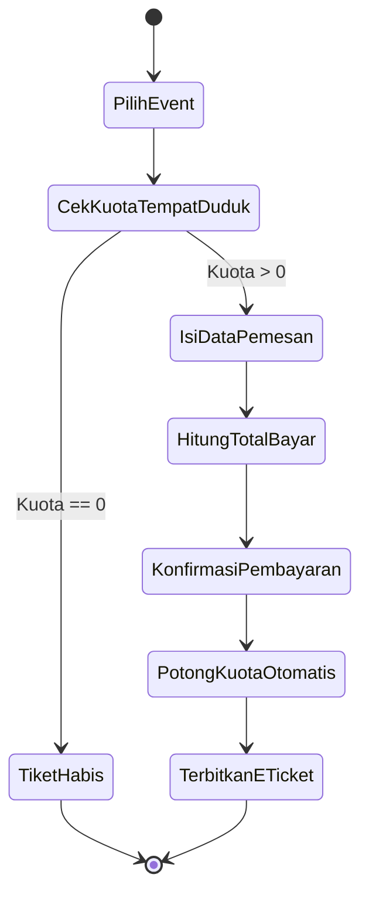
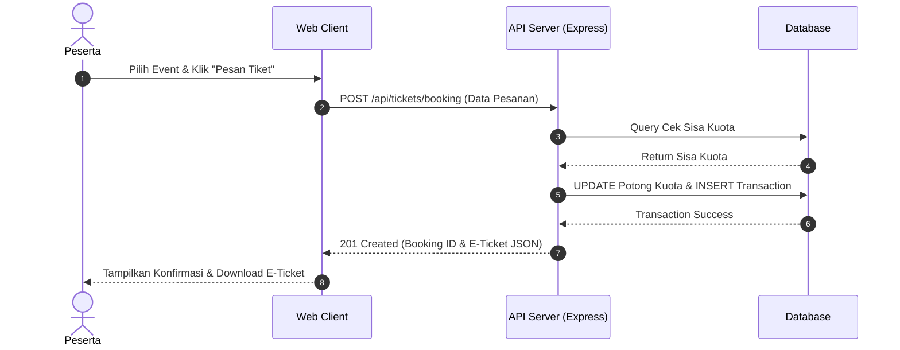

# 📚 Tugas Mata Kuliah: Analisis & Pengujian Sistem IF7A

**Mata Kuliah:** Analisis & Pengujian Sistem

**Ketua Kelompok:** Abdullah Muhammad Muttaqim — 22EO10034

**Anggota Kelompok:**
- Nur Hidayat — 22EO1002
- Andika Putra Pratama — 22EO1009
- Rama Adya Ahmad — 22EO10024
- Feri Ages Refangga — 22EO10031

---

## 1. Deskripsi Proyek (20 Poin)

Repositori ini berisi artefak, dokumen, dan kode yang berkaitan dengan tugas mata kuliah Analisis & Pengujian Sistem.

Proyek ini bertujuan untuk merancang, mengimplementasikan, dan menguji **Sistem Booking & Event Ticketing Online** berbasis REST API. Sistem ini menangani pendaftaran acara/seminar, verifikasi kuota tempat duduk secara *real-time*, pemotongan kuota otomatis, kalkulasi skema diskon, serta penerbitan struktur *e-ticket* berformat digital untuk menghindari *overbooking*.

## 2. Desain Proyek — Unified Modeling System (20 Poin)

### 2.1. Use Case Diagram

Diagram ini menggambarkan interaksi antara peserta event dan panitia/admin dengan sistem pemesanan tiket.

### 2.2. Activity Diagram — Alur Pemesanan dan Pemotongan Kuota

Diagram ini menggambarkan alur pemesanan tiket, mulai dari pemilihan event hingga penerbitan *e-ticket*, termasuk pemeriksaan ketersediaan kuota.

### 2.3. Sequence Diagram — Skenario Checkout Pesanan

Diagram ini menggambarkan komunikasi antara peserta, web client, API server, dan database selama proses pemesanan tiket.

## 3. Arsitektur Proyek — Unified Modeling System (20 Poin)

Sistem dirancang menggunakan **Layered Architecture (3-Tier Architecture)** dengan pembagian komponen sebagai berikut.

1. **Presentation Layer (Client Side)**

   Menggunakan React / Next.js sebagai antarmuka pemesanan tiket peserta dan dashboard penyelenggara.

2. **Application / Logic Layer (Server Side)**

   Menggunakan Node.js dengan Express.js untuk menangani logika bisnis pemesanan, verifikasi kuota, dan transaksi.

3. **Data Layer (Database)**

   Menggunakan PostgreSQL / Supabase untuk menyimpan data pengguna, detail acara, kuota tiket, dan histori transaksi.

4. **Testing Layer**

   Menggunakan Jest & Supertest untuk mengeksekusi pengujian otomatis (*unit testing*) pada fungsi validasi kuota dan kalkulasi harga tiket.

## 4. Tech Stack (20 Poin)

| Komponen | Teknologi |
|---|---|
| Frontend (FE) | React / Next.js |
| Backend (BE) | Node.js (Express.js) |
| Database | PostgreSQL / Supabase |
| Testing | Jest (Unit Testing), Supertest |
| Version Control & Repository | Git / GitHub |
